# ForgeOps — Canonical System Architecture

**Authoritative Visual Specification and Comprehensive Architecture Manual**  
**Repository:** [github.com/parag8487/ForgeOps](https://github.com/parag8487/ForgeOps)  
**Branch:** `phase-2-implementation`  
**License:** FSL-1.1-ALv2 (Platform / Control Plane) / Apache-2.0 (Agent)  
**Document Status:** Canonical Reference Document (Release 2.4.0)

---

## 1. Executive Summary & Architectural Overview

ForgeOps is an autonomous, self-healing DevOps automation platform and control plane that provisions, verifies, containerizes, and deploys fullstack web applications to local container engines, GitHub cloud repositories, and Vercel edge infrastructure.

Unlike traditional CI/CD engines that execute unstructured, imperative shell scripts with superficial success indicators, ForgeOps operates as an **immutable, state-machine driven autonomous deployment orchestrator**. Every mutating operation passes through a six-stage **Governance Chokepoint** governed by Open Policy Agent (OPA) and Cerbos ABAC, ensuring that neither autonomous AI generators nor rogue actors can execute unauthorized operations.

The runtime architecture guarantees:

1. **Deterministic Port Authority**: The operator's explicitly declared container port (e.g. `8080`) overrides all framework defaults (such as Vite's `3000`), with runtime injection of `PORT={container_port}` and `HOST=0.0.0.0`.
2. **Browser Port Safety Guard**: Host ports matching the Chromium/WHATWG 77 restricted bad-port list (such as `4045` `ERR_UNSAFE_PORT`) are rejected at schema validation and G3 static audit.
3. **Native BuildKit v2 Tar Streaming**: The Docker Engine client communicates directly with `/var/run/docker.sock` over Unix Domain Sockets (UDS) using BuildKit HTTP API `version=2`, protobuf trace demuxing (`moby.buildkit.trace`), and stable scoped cache mounts (`id=npm-{tenant}-{proj}`), with automatic fallback to the legacy Docker V1 builder.
4. **Sequential Verification Gates (G1–G7)**: Workloads must pass sequential verification gates (G1 baseline, G2 synthesis, G3 consistency audit, G4 context build, G5 container launch, G6 live HTTP 200 convergence, G7 multi-target cryptographic sign-off).
5. **Bounded Non-Destructive Self-Healing (G8)**: Runtime and port failures trigger bounded recovery (max 3 iterations) that remediates deployment manifests and port bindings while **strictly forbidding any modification to user application source code**.

---

## 2. Complete Canonical Architecture Diagram

The flowchart below unifies all eight subsystems of the ForgeOps platform into a single coherent, comprehensive architectural representation. It illustrates the exact directionality of HTTP requests, WebSocket sessions, Redis task dispatches, BuildKit streams, gate transitions, and cryptographic verification receipts.

```mermaid
flowchart TB
    %% =========================================================================
    %% 8. Automated Ubuntu Setup & Host Environment
    %% =========================================================================
    subgraph HOST_ENV["8. Automated Ubuntu Host Environment & Setup Engine"]
        SETUP_SH["<b>setup.sh Launcher</b><br/>1-Click Master Bootstrapper<br/>Dpkg lock wait, RAM/swap auto-tune"]
        DOCKER_DAEMON["<b>Docker Engine 29.7</b><br/>daemon.json, buildx v2 plugin<br/>Rootless-safe docker group isolation"]
        PORT_ALLOC["<b>Port Authority Allocator</b><br/>Dynamic collision resolution<br/>Deterministic .env configuration"]
        INTERNAL_CA["<b>Internal CA & Key Vault</b><br/>Cryptographic secret generator<br/>mTLS device cert authority"]
    end

    %% =========================================================================
    %% 1. User Entry Points & UI
    %% =========================================================================
    subgraph UI_SYS["1. User Entry Points & UI Subsystem"]
        NEXT_APP["<b>Next.js 16 Web Dashboard</b><br/>React 19 App Router (Port 13000)<br/>Radar charts, Artifact viewer, Diff inspector"]
        SSE_CLIENT["<b>SSE Real-Time Stream Consumer</b><br/>Typed EventSource connection<br/>Monotonic progress & token rendering"]
        WS_CLIENT["<b>Agent WebSockets Session Handler</b><br/>Terminal & scan activity stream<br/>Interactive human review controls"]
    end

    %% =========================================================================
    %% 2. Security, Auth & Governance
    %% =========================================================================
    subgraph SEC_SYS["2. Security, Auth & Governance Subsystem"]
        AK_OIDC["<b>Authentik IdP 2026.5.6</b><br/>OIDC / OAuth 2.1 Provider (Port 19000)<br/>PKCE, Split-horizon, JWKS rotation"]
        CERBOS_PDP["<b>Cerbos 0.54.0 Sidecar</b><br/>ABAC Policy Decision Point (Port 3592)<br/>Resource & tenant-scoped permission checks"]
        OPA_CHOKE["<b>GovernanceChokepoint & OPA 1.4.2</b><br/>Single mutation gate (Port 18182)<br/>Rego policies, blast radius evaluation"]
        TENANT_GUARD["<b>Tenant & Cryptographic Sealer</b><br/>Envelope HMAC-SHA256 signer<br/>Strict per-tenant row isolation"]
    end

    %% =========================================================================
    %% 3. Backend API & Core Services
    %% =========================================================================
    subgraph API_SYS["3. Backend API & Core Services (FastAPI 0.139, Port 18000)"]
        REST_ROUTERS["<b>REST Routing Surface</b><br/>Projects, Deployments, Analysis<br/>Approvals, Policies, Secrets, Integrations"]
        OUTBOX_PROC["<b>Transactional Outbox Engine</b><br/>PostgreSQL sequence-counter queue<br/>Atomic commit with mutation events"]
        AGENT_HUB["<b>mTLS Agent Hub (Port 18443)</b><br/>Dedicated dual-secret listener<br/>Client cert + Token verification"]
        SSE_RELAY["<b>SSE Stream Broadcaster</b><br/>Ordered event streaming (/stream)<br/>Strict monotonic sequence delivery"]
    end

    %% =========================================================================
    %% 4. Async Worker & Queues
    %% =========================================================================
    subgraph QUEUE_SYS["4. Async Processing, Queue & State Plane"]
        REDIS_QUEUE[("<b>Redis Stack 7.4 (Port 16379)</b><br/>ARQ job queue, L1/L2 semantic cache<br/>Task streams & rate limiters")]
        ARQ_WORKER["<b>ARQ Background Worker</b><br/>Distributed task consumer<br/>Monotonic fence token execution"]
        POSTGRES_DB[("<b>PostgreSQL 17 (Port 15432)</b><br/>Relational runs, change sets, audit log<br/>pgvector HNSW cosine embeddings")]
        OLLAMA_SRV["<b>Ollama AI Cluster</b><br/>Primary (11434) + Standby (11435)<br/>qwen3-coder-next + bge-m3 embeddings"]
    end

    %% =========================================================================
    %% 5. Autonomous Deployment Orchestration (G1-G7)
    %% =========================================================================
    subgraph ORCH_SYS["5. Autonomous Deployment Orchestration Pipeline"]
        READINESS_ENG["<b>ReadinessEngine & Scanner</b><br/>5 operational pillars (0-100 score)<br/>Pre-G1 AST dependency index"]
        GEN_SERVICE["<b>GenerationService & Synthesizer</b><br/>Multi-stage Dockerfile synthesis<br/>Kubernetes manifests & OpenTofu plans"]

        subgraph GATES_PIPELINE["Strict Sequential Gate Pipeline (G1-G7) & G8 Recovery"]
            G1_GATE["<b>G1: Blueprint Baseline</b><br/>Strategy constraints & R0 score"]
            G2_GATE["<b>G2: Synthesis & Template</b><br/>Vite, Node, Py, Go blueprints & R1 score"]
            G3_GATE["<b>G3: Consistency Audit</b><br/>77 browser-bad ports guard & port range"]
            G4_GATE["<b>G4: Secure Build & Compile</b><br/>Context isolation, credentials exclusion"]
            G5_GATE["<b>G5: Container Apply Engine</b><br/>Port authority & HOST/PORT injection"]
            G6_GATE["<b>G6: Workload Convergence</b><br/>Inspect verification & HTTP 200 readiness probe"]
            G7_GATE["<b>G7: Cryptographic Verification</b><br/>Physical PortBindings, Commit, Alias check"]
            G8_RECOV["<b>G8: Bounded Self-Healing</b><br/>Max 3 iterations, zero app source mutation"]
        end
    end

    %% =========================================================================
    %% 6. Docker Engine Integration & BuildKit Pipeline
    %% =========================================================================
    subgraph BUILDKIT_SYS["6. Docker Engine Integration & BuildKit Pipeline"]
        DOCKER_UDS["<b>Docker UDS Client</b><br/>Unix Domain Socket (/var/run/docker.sock)<br/>Direct HTTP Engine API (no shell)"]
        BUILDKIT_V2["<b>BuildKit v2 Engine</b><br/>Direct graph evaluation API<br/>Tar stream context transmission"]
        TRACE_DEMUX["<b>Protobuf Trace Demuxer</b><br/>moby.buildkit.trace decoder<br/>Live step-by-step telemetry"]
        CACHE_MOUNTS["<b>Scoped Cache Mounts</b><br/>id=npm-{clean_tenant}-{clean_proj}<br/>Fast incremental compilation"]
        V1_FALLBACK["<b>Legacy V1 Builder Fallback</b><br/>Graceful automatic fallback<br/>Standard docker build demuxing"]
    end

    %% =========================================================================
    %% 7. External Targets & Integrations
    %% =========================================================================
    subgraph TARGETS_SYS["7. External Deployment Targets & Integrations"]
        LOCAL_CONTAINER["<b>Local Docker Container</b><br/>Port bound on host (127.0.0.1:HostPort)<br/>Isolated bridge network execution"]
        GITHUB_TARGET["<b>GitHub Git Data API</b><br/>api.github.com direct tree sync<br/>Blobs, Trees, Commits, Branch Ref update"]
        VERCEL_TARGET["<b>Vercel Edge Deployment</b><br/>api.vercel.com REST deployment<br/>Hashed assets, SPA rewrite, Assigned alias"]
        GO_AGENT["<b>Local Go Host Agent</b><br/>Signed static binary on developer host<br/>Whitelisted fileops & container actions"]
    end

    %% Directionality & Inter-Subsystem Links
    %% Host bootstrap
    SETUP_SH -->|"Configures daemon"| DOCKER_DAEMON
    SETUP_SH -->|"Resolves ports"| PORT_ALLOC
    SETUP_SH -->|"Generates keys"| INTERNAL_CA

    %% UI to Security & API
    NEXT_APP -->|"1. OIDC Authorization Code + PKCE"| AK_OIDC
    NEXT_APP -->|"2. Authenticated REST Requests (JWT)"| REST_ROUTERS
    NEXT_APP -->|"3. EventSource Listen"| SSE_CLIENT
    SSE_CLIENT -->|"Long-polling SSE stream"| SSE_RELAY

    %% Security flow
    REST_ROUTERS -->|"Inspect user claims"| AK_OIDC
    REST_ROUTERS -->|"Authorise action on resource"| CERBOS_PDP
    REST_ROUTERS -->|"Pass mutation intent"| OPA_CHOKE
    OPA_CHOKE -->|"Sign with HMAC-SHA256"| TENANT_GUARD

    %% API to Queues & Persistence
    REST_ROUTERS -->|"Atomic write mutation event"| OUTBOX_PROC
    OUTBOX_PROC -->|"Persist run state & audit log"| POSTGRES_DB
    REST_ROUTERS -->|"Enqueue deployment job"| REDIS_QUEUE
    REDIS_QUEUE -->|"Dequeue execution job"| ARQ_WORKER

    %% Worker to Orchestration
    ARQ_WORKER -->|"Run readiness scan"| READINESS_ENG
    READINESS_ENG -->|"Cosine similarity retrieval"| POSTGRES_DB
    READINESS_ENG -->|"Embedding vectors"| OLLAMA_SRV
    ARQ_WORKER -->|"Synthesize blueprints & manifests"| GEN_SERVICE
    GEN_SERVICE -->|"LLM code completion"| OLLAMA_SRV

    %% Orchestration Gate Progression
    GEN_SERVICE --> G1_GATE
    G1_GATE -->|"G1 Verified"| G2_GATE
    G2_GATE -->|"G2 Synthesized"| G3_GATE
    G3_GATE -->|"G3 Audited"| G4_GATE
    G4_GATE -->|"G4 Built"| G5_GATE
    G5_GATE -->|"G5 Launched"| G6_GATE
    G6_GATE -->|"G6 Converged"| G7_GATE
    G6_GATE -.->|"Failure detected"| G8_RECOV
    G7_GATE -.->|"Non-converged target"| G8_RECOV
    G8_RECOV -->|"Remediate manifests (max 3 iters)"| G2_GATE

    %% G4 / G5 to BuildKit and Docker UDS
    G4_GATE -->|"Initiate build session"| DOCKER_UDS
    DOCKER_UDS -->|"BuildKit v2 endpoint"| BUILDKIT_V2
    BUILDKIT_V2 -->|"Stream tarball context"| CACHE_MOUNTS
    BUILDKIT_V2 -->|"Binary trace frames"| TRACE_DEMUX
    BUILDKIT_V2 -.->|"Fallback if unsupported"| V1_FALLBACK
    TRACE_DEMUX -->|"Formatted log lines"| SSE_RELAY
    V1_FALLBACK -->|"Build stream text"| SSE_RELAY

    %% Deployment Actions to Targets
    G5_GATE -->|"Create & start container via UDS"| LOCAL_CONTAINER
    G6_GATE -->|"HTTP readiness probe (1.5s poll)"| LOCAL_CONTAINER
    ORCH_SYS -->|"Git Data API commit & tree sync"| GITHUB_TARGET
    ORCH_SYS -->|"REST deploy & alias resolution"| VERCEL_TARGET

    %% Agent communications
    REST_ROUTERS <-->|"JSON-RPC 2.0 over mTLS WSS"| AGENT_HUB
    AGENT_HUB <-->|"Signed command envelopes"| GO_AGENT
    GO_AGENT -->|"Source AST scan & whitelisted fileops"| REST_ROUTERS

    %% Final Verification & Receipt Persistence
    G7_GATE -->|"Verify exact HostConfig.PortBindings"| LOCAL_CONTAINER
    G7_GATE -->|"Verify remote commit SHA presence"| GITHUB_TARGET
    G7_GATE -->|"Verify assigned production alias (HTTP 200)"| VERCEL_TARGET
    G7_GATE -->|"Record Cryptographic Operational Receipt"| POSTGRES_DB
    ARQ_WORKER -->|"Broadcast final state & receipt"| SSE_RELAY

    %% Styling & Classes
    classDef ui fill:#e1f5fe,stroke:#0288d1,stroke-width:2px,color:#01579b
    classDef security fill:#fff8e1,stroke:#fbc02d,stroke-width:2px,color:#f57f17
    classDef api fill:#e8f5e9,stroke:#43a047,stroke-width:2px,color:#1b5e20
    classDef queue fill:#ede7f6,stroke:#7e57c2,stroke-width:2px,color:#311b92
    classDef orch fill:#fff3e0,stroke:#fb8c00,stroke-width:2px,color:#e65100
    classDef buildkit fill:#f3e5f5,stroke:#ab47bc,stroke-width:2px,color:#4a148c
    classDef targets fill:#e0f2f1,stroke:#26a69a,stroke-width:2px,color:#004d40
    classDef host fill:#eceff1,stroke:#78909c,stroke-width:2px,color:#263238

    class NEXT_APP,SSE_CLIENT,WS_CLIENT ui
    class AK_OIDC,CERBOS_PDP,OPA_CHOKE,TENANT_GUARD security
    class REST_ROUTERS,OUTBOX_PROC,AGENT_HUB,SSE_RELAY api
    class REDIS_QUEUE,ARQ_WORKER,POSTGRES_DB,OLLAMA_SRV queue
    class READINESS_ENG,GEN_SERVICE,G1_GATE,G2_GATE,G3_GATE,G4_GATE,G5_GATE,G6_GATE,G7_GATE,G8_RECOV orch
    class DOCKER_UDS,BUILDKIT_V2,TRACE_DEMUX,CACHE_MOUNTS,V1_FALLBACK buildkit
    class LOCAL_CONTAINER,GITHUB_TARGET,VERCEL_TARGET,GO_AGENT targets
    class SETUP_SH,DOCKER_DAEMON,PORT_ALLOC,INTERNAL_CA host
```



---

## 3. Subsystem Architectural Deep-Dives

### 3.1 Subsystem 1: User Entry Points & UI Layer

- **Technology**: Next.js 16 (React 19 App Router), Tailwind CSS, TanStack Query, Zustand.
- **Port Mapping**: Host port `13000` (container internal `3000`).
- **Core Responsibilities**:
  - **OIDC / PKCE Authentication Flow**: Initiates split-horizon OIDC authorization against Authentik (`http://localhost:19000/application/o/authorize/`), storing session JWTs in `httpOnly`, `SameSite=Lax` cookies.
  - **Deployment Studio & Multi-Target Selector**: Provides intuitive configuration of targets (`docker_github_vercel`, `docker_github`, `vercel_only`, `github_only`), host/container port bindings, and repository links.
  - **Live Monotonic SSE Terminal**: Establishes an `EventSource` connection to `/api/v1/autonomous/deployments/{run_id}/stream`, streaming chunked tokens, BuildKit compilation traces, and verification badges with monotonic sequence numbering.
  - **Visual Verification Badges**: Dynamically updates G1 through G7 execution state chips and renders the plain-language readiness radar breakdown.

### 3.2 Subsystem 2: Security, Auth & Governance

- **Identity Provider (Authentik 2026.5.6)**: Pinned at port `19000` (`authentik-server` + `authentik-worker`). Evaluates OIDC scopes, issuing RSA-256 tokens with verified user identity, roles, and tenant metadata.
- **Cerbos ABAC Sidecar (v0.54.0)**: Pinned at port `3592`. Evaluates YAML-defined Attribute-Based Access Control policies (`policies/cerbos/`), answering: _"May principal P perform action A on resource R within tenant T?"_ Denies by default on network disconnect.
- **Open Policy Agent (OPA 1.4.2)**: Evaluates high-integrity Rego policies (`policies/agent/governance.rego` and `policies/mcp/`) at port `18182`. Calculates mutation blast radius and verifies scheduled execution windows.
- **Governance Chokepoint (`src/governance/chokepoint.py`)**: Architectural choke through which every mutating operation must pass. Verified by property test Q-03 to be mathematically unbypassable. Mints tamper-evident HMAC-SHA256 signed command envelopes.

### 3.3 Subsystem 3: Backend API & Core Services

- **Technology**: FastAPI 0.139 / Python 3.13 running via Uvicorn. Pinned at port `18000` (internal `8000`).
- **REST Routing Domains**: Exposes 27 structured application domains across 135+ route handlers (`/api/v1/auth`, `/projects`, `/analysis`, `/deployments`, `/autonomous`, `/approvals`, `/audit`, `/policies`, `/secrets`).
- **Transactional Outbox Engine (`src/deployments/autonomous_service.py`)**: Prevents distributed race conditions between state mutations and streaming notifications. Writes events into the PostgreSQL outbox table within the same database transaction as the state transition.
- **Dedicated mTLS Agent Listener (`src/agent_listener.py`)**: Runs on port `18443` (internal `8443`). Implements dual-secret authentication (`ssl_cert_reqs=CERT_REQUIRED` plus bearer token), terminating TLS connections from paired host agents.
- **SSE Stream Broadcaster**: Long-polling asynchronous event pump delivering strictly ordered lifecycle events to connected browsers.

### 3.4 Subsystem 4: Async Processing, Task Queues & State Plane

- **Distributed Job Queue (ARQ 0.26.3 & Redis Stack 7.4)**: Redis pinned at port `16379`. Offloads long-running deployment orchestration jobs (`autonomous_deploy_run`) to background worker processes, preventing HTTP request timeouts.
- **Worker Custody & Fencing Tokens**: Autonomous worker instances acquire 60-second database leases. Monotonic integer fence tokens prevent split-brain execution across worker restarts.
- **Relational Storage (PostgreSQL 17 + pgvector 0.3.6)**: Pinned at port `15432`. Stores relational models for projects, runs, stages, change sets, immutable audit trails, and HNSW cosine vector embeddings.
- **Semantic Vector & AI Cluster (Ollama 0.12.6)**: Primary Ollama server (`port 11434`) hosting `qwen3-coder-next` (code synthesis) and `bge-m3:567m` (embeddings). A secondary standby container (`port 11435`) shares weights and provides automated cross-endpoint circuit breaker failover.

### 3.5 Subsystem 5: Autonomous Deployment Orchestration (G1–G7 & G8)

The core deployment engine executes an immutable state machine where each run sequentially traverses verification gates:

- **G1 (Blueprint Baseline)**: Validates strategy configuration, checks directory traversal safety, and calculates baseline operational readiness ($R_0$).
- **G2 (Synthesis & Template Library)**: Synthesizes production-grade multi-stage Dockerfiles (configuring `PORT`, `HOST=0.0.0.0`, `EXPOSE`, and startup commands) or reuses validated existing manifests. Measures post-generation readiness ($R_1$).
- **G3 (Consistency & Browser Port Audit)**: Enforces numeric port boundaries ($1 \le \text{port} \le 65535$) and checks against all 77 Chromium/WHATWG browser-restricted ports (rejecting ports like `4045`, `6000`, `6666`).
- **G4 (Context Build & Isolation)**: Security audit excluding sensitive files (`.git`, `.env*`, `*.pem`, `*.key`), verifying symlink confinement, and validating image context boundaries.
- **G5 (Container Apply)**: Launches containers via Docker Engine API over UDS, applying strict port bindings (`{container_port}/tcp: {host_port}`) and injecting environment variables (`PORT={container_port}`, `HOST=0.0.0.0`).
- **G6 (Workload Convergence)**: Real-time container inspect verification and HTTP readiness probing (polling at 1.5s intervals) with fast-failure on connection refusal or non-200 status.
- **Cloud Execution Steps**:
  - `github_release`: Pushes project workspace blobs, creates Git trees, commits changes, and updates branch references via low-level GitHub Git Data API.
  - `vercel_deploy`: Hashes workspace files, uploads missing SHA assets, initiates deployment via Vercel REST API, polls for `READY`, and captures production aliases.
- **G7 (Cryptographic Verification)**: Multi-target validation verifying exact container port bindings (`HostConfig.PortBindings`), live remote GitHub commit presence, and Vercel assigned production alias accessibility (bypassing SSO walls and rejecting synthetic placeholder content).
- **G8 (Bounded Self-Healing & Crash Sweeper)**: Bounded AI remediation loop (max 3 iterations) that resolves non-code failures (port collisions, configuration errors) while strictly forbidding application code modifications. A background sweeper reclaims orphaned worker leases.

### 3.6 Subsystem 6: Docker Engine Integration & BuildKit Pipeline

- **Native UDS Transport**: Backend and workers communicate with `/var/run/docker.sock` using `httpx.AsyncHTTPTransport(uds="/var/run/docker.sock")`, eliminating insecure shell subprocesses (`exec("docker build")`).
- **BuildKit v2 HTTP Streaming**: Initiates builds via `POST /v1.47/build?version=2`. Builds an in-memory tar stream of workspace files, streaming bytes directly to the engine without temporary disk bloat.
- **Protobuf Trace Demuxer (`moby.buildkit.trace`)**: Demultiplexes binary BuildKit trace streams, extracting live step statuses, cache hits, layer IDs, and compile errors into clean user logs.
- **Scoped Cache Mounts**: Injects deterministic `--mount=type=cache,id=npm-{clean_tenant}-{clean_proj},target=/root/.npm` instructions into synthesized Dockerfiles, accelerating rebuilds while isolating tenant caches.
- **Graceful V1 Fallback**: Automatically catches BuildKit negotiation errors or unsupported daemon flags, seamlessly falling back to Docker Engine V1 tar builder without failing the deployment.

### 3.7 Subsystem 7: External Targets & Integrations

- **Local Container Target**: Directly managed bridge network container publishing `127.0.0.1:{host_port}:{container_port}`.
- **GitHub Target**: Pure API-driven synchronization using GitHub Git Data API (Blobs $\rightarrow$ Trees $\rightarrow$ Commits $\rightarrow$ Refs). Does not require local `git` binary.
- **Vercel Target**: Direct edge deployment via Vercel REST API (`POST /v13/deployments`) with automated SPA routing injection (`vercel.json` rewrite rule) and production alias resolution.
- **Go Local Agent**: Static Go binary on developer host connected via outbound-only WSS. Executes whitelisted local file operations and AST scans with zero external open ports.

### 3.8 Subsystem 8: Automated Ubuntu Host Environment

- **`setup.sh` Launcher**: Single-click shell bootstrapper supporting Ubuntu 22.04 LTS, 24.04 LTS, and 20.04 LTS.
- **Lock & Package Management**: Waits up to 5 minutes for Ubuntu `unattended-upgrades` to release `dpkg` locks before provisioning Docker CE, containerd, and plugins.
- **Rootless-Safe Permissions**: Automatically configures the `docker` user group (`usermod -aG docker`) without ever opening insecure world-writable socket permissions (`chmod 666`).
- **Low-Memory & Safe Swap Protection**: Under 2.5 GB available RAM, checks for non-Btrfs/ZFS filesystems and creates a safe 2 GB swapfile, preventing OOM build aborts.
- **Dynamic Port Authority & Secrets**: Probes host network for available ports, writes verified values to `.env`, and generates cryptographic keys and internal CAs.

---

## 4. End-to-End Control, Data & Artifact Flow

| Step               | Initiator    | Receiver        | Transport           | Payload / Operation                                     | Verification Guarantee                              |
| :----------------- | :----------- | :-------------- | :------------------ | :------------------------------------------------------ | :-------------------------------------------------- |
| **1. Login**       | User Browser | Authentik IdP   | HTTPS / OIDC        | Authorization code + PKCE challenge                     | Issues signed RSA-256 JWT with tenant claims.       |
| **2. Deploy Init** | User Browser | FastAPI API     | HTTPS POST          | Strategy, Host/Container Port, Project ID               | Validates browser-safe ports; returns Run ID.       |
| **3. Dispatch**    | FastAPI API  | ARQ / Redis     | Redis Stream        | Enqueue `autonomous_deploy_run` job                     | Atomic outbox entry written in same DB transaction. |
| **4. G1 Check**    | ARQ Worker   | File System     | Local Disk / AST    | Read project files, verify strategy constraints         | Asserts $R_0$ baseline readiness.                   |
| **5. G2 Synth**    | ARQ Worker   | GenerationSvc   | In-Process / Ollama | Synthesize Dockerfile / manifests with `PORT`           | Asserts $R_1 \ge R_0$ readiness progression.        |
| **6. G3 Audit**    | ARQ Worker   | Validator       | In-Process          | Audit port ranges and 77 unsafe browser ports           | Strictly rejects forbidden ports (e.g. `4045`).     |
| **7. G4 Build**    | ARQ Worker   | Docker UDS      | BuildKit v2 HTTP    | Stream tarball context over `/var/run/docker.sock`      | BuildKit trace demuxed; caches mounted.             |
| **8. G5 Apply**    | ARQ Worker   | Docker UDS      | Engine API POST     | Container create & start with `HostConfig.PortBindings` | Container running with `PORT` and `HOST=0.0.0.0`.   |
| **9. G6 Probe**    | ARQ Worker   | Container       | HTTP GET Probe      | Poll `http://127.0.0.1:{host_port}/` every 1.5s         | Live HTTP 200 response verified.                    |
| **10. Cloud Sync** | ARQ Worker   | GitHub / Vercel | HTTPS REST          | Git Data API tree commit; Vercel asset upload           | Remote commit SHA and assigned alias captured.      |
| **11. G7 Verify**  | ARQ Worker   | Multi-Target    | HTTP / Inspection   | Cross-verify physical bindings, SHA, alias HTTP 200     | All active targets verified; receipt minted.        |
| **12. Receipt**    | ARQ Worker   | PostgreSQL      | SQLModel Async      | Persist signed Operational Artifacts receipt            | Run marked `succeeded`; SSE terminal completes.     |

---

## 5. Deterministic Port Authority & Browser Safety

The platform implements strict mathematical port governance across all layers:

```
Declared Container Port (e.g. 8080)
   ├── G2 Blueprint Synthesis  ──> Injects "ENV PORT=8080" & "EXPOSE 8080"
   ├── G5 Container Launch     ──> Injects env "PORT=8080", "HOST=0.0.0.0"
   ├── G5 Port Binding         ──> Sets "8080/tcp: [{HostPort: 18080}]"
   ├── G6 Readiness Probing    ──> Probes candidate endpoint on host port 18080
   └── G7 Final Verification   ──> Asserts HostConfig.PortBindings["8080/tcp"] == 18080
```

### Browser-Restricted Ports Rejected at Schema Validation & G3

The system strictly rejects all 77 Chromium and WHATWG bad ports, including:

- `1` (tcpmux), `7` (echo), `9` (discard), `11` (systat), `13` (daytime), `15` (netstat), `17` (qotd), `19` (chargen), `20` (ftp data), `21` (ftp control), `22` (ssh), `23` (telnet), `25` (smtp), `37` (time), `42` (name), `43` (nicname), `53` (domain), `77` (rje), `79` (finger), `87` (ttylink), `95` (supdup), `101` (hostriame), `102` (iso-tsap), `103` (gppitnp), `104` (acr-nema), `109` (pop2), `110` (pop3), `111` (sunrpc), `113` (auth), `115` (sftp), `117` (uucp-path), `119` (nntp), `123` (ntp), `135` (epmap), `139` (netbios), `143` (imap2), `179` (bgp), `389` (ldap), `465` (smtp submission), `512` (biff), `513` (who), `514` (syslog), `515` (printer), `526` (tempo), `530` (courier), `531` (conference), `532` (netnews), `540` (uucp), `556` (remotefs), `563` (nntp-ssl), `587` (submission), `601` (syslog), `636` (ldap-ssl), `993` (imap-ssl), `995` (pop-ssl), `2049` (nfs), `3659` (apple-sasl), `4045` (lockd/nfs), `6000` (x11), `6665-6669` (irc), `6697` (irc-ssl).

---

## 6. Cryptographic Verification & Receipts Contract

When G7 concludes successfully, it writes an immutable cryptographic record to the database and outbox:

```json
{
  "run_id": "018f3a5b-7b2c-7994-b102-39c8e8d2491a",
  "project_id": "018f3a5b-6a10-7221-a541-10d9f4c1822e",
  "strategy": "docker_github_vercel",
  "effective_ports": {
    "host_port": 18080,
    "container_port": 8080,
    "browser_safe": true
  },
  "verifications": {
    "docker": {
      "verified": true,
      "container_id": "d8f1e29c8172...",
      "exact_port_binding": "8080/tcp -> 127.0.0.1:18080",
      "http_status": 200
    },
    "github": {
      "verified": true,
      "repository": "parag8487/Portfolio",
      "commit_sha": "4a7b9c1d2e3f...",
      "ref": "refs/heads/main"
    },
    "vercel": {
      "verified": true,
      "deployment_id": "dpl_8u1j2k3l4m...",
      "assigned_alias": "portfolio-parag.vercel.app",
      "alias_http_status": 200,
      "sso_bypassed": true
    }
  },
  "readiness": {
    "baseline_r0": 82,
    "post_generation_r1": 96
  },
  "receipt_timestamp": "2026-10-16T07:00:00Z"
}
```

---

## 7. Architectural Invariants & Related Documentation

- **Master Technical Document**: See [`FORGEOPS_PROJECT_MASTER_DOCUMENT.md`](file:///C:/IMP/antigravity-cli/Major%20Project/Devops%20Automation/FORGEOPS_PROJECT_MASTER_DOCUMENT.md) for full project specifications, G1–G7 gate rules, and evaluation benchmarks.
- **Architecture Diagrams**: See [`ARCHITECTURE-DIAGRAMS.md`](file:///C:/IMP/antigravity-cli/Major%20Project/Devops%20Automation/ARCHITECTURE-DIAGRAMS.md) for the original three-component layout and Phase 1 journey criteria flow.
- **Progress Tracking & Verification Evidence**: See [`PROGRESS.md`](file:///C:/IMP/antigravity-cli/Major%20Project/Devops%20Automation/PROGRESS.md) for per-criterion test runs and gate records.
- **Verification Harness**: Run `bash scripts/check-architecture-diagrams.sh` to mechanically verify diagram consistency against `docker-compose.yml`, Dockerfiles, and `PROGRESS.md`.
